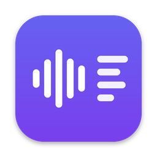

<p align="center">
  
</p>

# scribe-kun（ビデオから文字起こし）

動画・音声ファイルをウィンドウにドロップするだけで、**Mac の中だけで**文字起こししてテキストファイルに書き出す macOS アプリです。
音声や文字起こし結果を外部に送信することはありません（通信するのは初回のモデルダウンロードだけです）。

- 対象：macOS 14 Sonoma 以降、Apple Silicon（M1 以降）の Mac
- 実装：Swift / SwiftUI ＋ [whisper.cpp](https://github.com/ggml-org/whisper.cpp)（Metal で GPU 処理）
- 仕様書：[docs/SPEC.md](docs/SPEC.md)

## インストール

1. [Releases](https://github.com/narurea/scribe-kun/releases) から `scribe-kun-<バージョン>.dmg` をダウンロードして開く
2. `scribe-kun` を `Applications` フォルダにドラッグする
3. 初回だけ、次の手順で開く（作者はお金がなくて月額が払えないため、appleの公証を受けられず、最初だけ少し怖い警告が表示されてしまいます。ごめんね）
   1. アプリケーションフォルダの `scribe-kun` をダブルクリック →「開けません」と出たら「完了」を押す
   2. **システム設定 → プライバシーとセキュリティ** を開き、下の方にある「“scribe-kun”は…」の横の **「このまま開く」** を押す
   3. もう一度「開く」を押し、パスワードを入力する

2回目以降は普通に開けます。

## できること

- ドラッグ&ドロップ、または「ファイルを選択」でファイルを追加（複数可、キューで1本ずつ処理）
- 対応形式：mp4 / mov / m4v / m4a / mp3 / wav
- 言語の自動判定（判定結果を一覧に表示）。設定で言語を固定することもできます
- 進捗（%）と経過時間の表示、キャンセル
- 出力形式（複数同時に選択可）
  | 形式 | ファイル名 | 中身 |
  | --- | --- | --- |
  | 本文のみ | `元の名前.txt` | 区切りごとに改行したテキスト |
  | タイムスタンプ付き | `元の名前_timestamps.txt` | 各行の頭に `[00:12:34]` |
  | 字幕 | `元の名前.srt` | SRT 字幕 |
- 同名ファイルがあるときは `_2`, `_3` … を付けて上書きしません
- 完了時に通知と「Finderで表示」ボタン

## 使い方

1. 初回起動時、モデル（large-v3-turbo、約1.6GB）のダウンロード案内が出るので「ダウンロード」を押す
2. 動画をウィンドウにドロップ
3. 終わったら「Finderで表示」で結果を開く

保存先の初期値は `~/Documents/Transcripts`（書類/Transcripts）です。設定（⌘,）で変更できます。

### モデル

| モデル | サイズ | 備考 |
| --- | --- | --- |
| large-v3-turbo | 約1.6GB | 既定。速さと精度のバランスが良い |
| large-v3 | 約3.1GB | 最も高精度だが遅い |
| small | 約490MB | 軽量・高速 |

モデルは `~/Library/Containers/io.github.narurea.scribe-kun/Data/Library/Application Support/scribe-kun/models/` に保存されます（App Sandbox のためコンテナ内になります）。

## 開発状況

v0.1（開発中）。仕様書 6.2 の「実際の動画で速度と精度を測る」以降はまだです。

## 開発者向け

### ビルド

Xcode プロジェクトは [XcodeGen](https://github.com/yonaskolb/XcodeGen) で `project.yml` から生成します（`.xcodeproj` はリポジトリに含めません）。

```sh
./scripts/bootstrap.sh     # Transcribe.xcodeproj を生成
open Transcribe.xcodeproj
```

Homebrew は不要です。XcodeGen が入っていなければ、`bootstrap.sh` が固定バージョンを `.tools/` にダウンロードして（チェックサム確認つき）使います。

Xcode で `Transcribe` スキームを選んで ⌘R で実行、⌘U でテストします。
whisper.cpp は公式リリースの XCFramework を Swift Package（[`Packages/Whisper`](Packages/Whisper/Package.swift)）経由で取得するので、初回ビルド時に自動でダウンロードされます。

署名は「Sign to Run Locally」（アドホック署名）です。

### DMG を作る

```sh
./scripts/make-dmg.sh 0.1.0    # build/scribe-kun-0.1.0.dmg ができる
```

### リリース

`v0.1.0` のようなタグを push すると、GitHub Actions が DMG を作って [Releases](https://github.com/narurea/scribe-kun/releases) に公開します（[`.github/workflows/release.yml`](.github/workflows/release.yml)）。
`v0.x` はプレリリース扱いになります。

```sh
git tag v0.1.0
git push origin v0.1.0
```

ブランチへの push ごとに、ビルド・テストと DMG の試作も自動で行われます（[`.github/workflows/ci.yml`](.github/workflows/ci.yml)）。

### アイコン

`scripts/make-icon.py` で描いています（要 Pillow）。変更したら `python3 scripts/make-icon.py` で `AppIcon.appiconset` を作り直します。

## ご利用にあたっての注意（免責事項）

- 本アプリは無保証で提供されます。動作、文字起こし結果の正確さ、特定の目的への適合性などについて、作者は一切保証しません
- 本アプリの利用方法は問わず、利用によって生じたいかなる損害・不利益・トラブル（データの消失、誤った文字起こしによる損害、第三者との紛争などを含む）についても、作者は責任を負いません。**すべて利用者自身の責任でご利用ください**
- 文字起こしする動画・音声の著作権や肖像権、プライバシーなどの権利関係は、利用者自身で確認してください

## ライセンス

[クリエイティブ・コモンズ 表示 - 非営利 - 改変禁止 4.0 国際（CC BY-NC-ND 4.0）](LICENSE)

| | |
| --- | --- |
| ✅ 再配布 | してよい（作者名「Rea Narukawa」とこのリポジトリへのリンク、ライセンスを明記すること） |
| 🚫 改造・改変したものの配布 | 禁止 |
| 🚫 営利目的での利用・配布 | 禁止（有料での配布・販売、配布による収益化を含む） |

正式な条件は [LICENSE](LICENSE) の本文が優先します。

同梱している whisper.cpp は MIT ライセンスです（[THIRD_PARTY_NOTICES.md](THIRD_PARTY_NOTICES.md)）。
